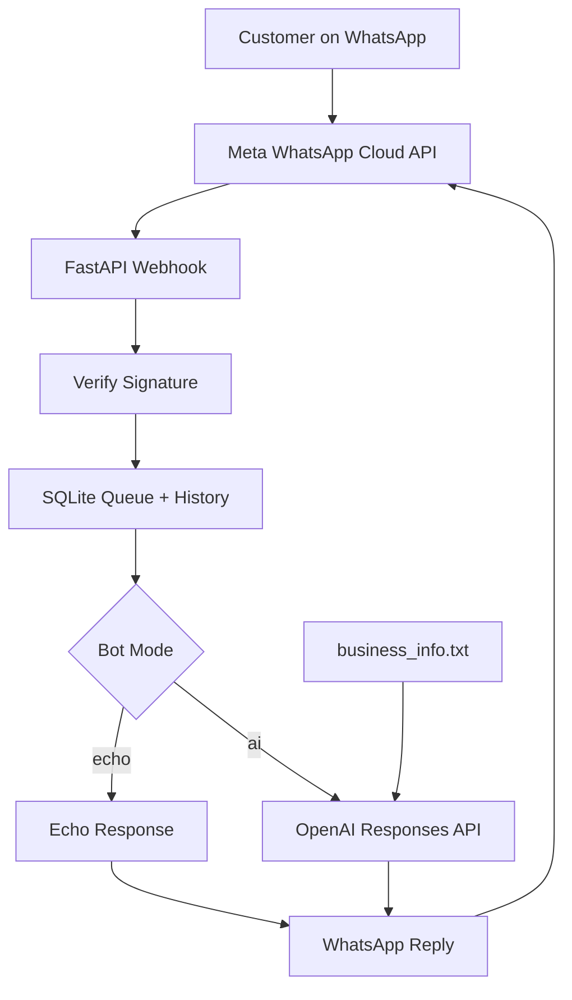

🤖 ChatFlow AI
Smart WhatsApp Business Customer-Support Bot
Automate customer replies with Python, FastAPI, Meta WhatsApp Cloud API, and OpenAI.

Features · Quick Start · WhatsApp Setup · Commands · Testing

📖 About
ChatFlow AI is an open-source-style, editable WhatsApp business support bot starter project. It receives incoming WhatsApp messages through Meta's official Cloud API, processes them in a Python/FastAPI backend, and sends automated replies.

Run it in echo mode to test the integration without using an AI model, or enable AI mode to answer business-related questions using OpenAI and the details you provide in business_info.txt.
[!IMPORTANT]
This project cannot directly automate a normal personal WhatsApp account. Start with Meta's WhatsApp Business Platform test sender number. Your normal WhatsApp can be used as a verified test recipient, so you don't need to move or delete your personal account to try the bot.

This project is intended for business customer support, not a general-purpose AI companion service. Follow Meta's current WhatsApp Business Platform policies.

✨ Features
- 💬 Automatic text replies to incoming WhatsApp messages
- 🧠 AI customer support, using the OpenAI Responses API
- 🌐 Sinhala, English & Singlish response capability (model-dependent)
- 🧪 Echo mode for initial testing without OpenAI usage
- 🏪 Business knowledge loaded from business_info.txt
- 🗃️ SQLite chat history, basic customer preferences, and a persistent message queue
- 🔐 Webhook verification and Meta signature validation
- 🔁 Duplicate-event detection and retry handling
- 🧑‍💼 Human-contact option that pauses the bot and shares configured contact information
- 🛑 Opt-out commands for customers
- 🐳 Docker support and automated tests
How it works

🛠️ Tech Stack
Layer	Technology
Programming language	Python 3.11+
API server	FastAPI + Uvicorn
Messaging	Meta WhatsApp Business Cloud API
AI integration	OpenAI Responses API via HTTPX
Data storage	SQLite
Testing	Pytest
Containerization	Docker

📁 Project Structure
chatflow-ai-whatsapp-bot/
├── app/
│   ├── __init__.py
│   ├── main.py              # Webhook routes and worker
│   ├── bot.py               # Echo/AI replies and commands
│   ├── config.py            # Environment settings
│   ├── storage.py           # SQLite queue and chat history
│   └── whatsapp.py          # Meta messaging API
├── scripts/
│   └── send_test_webhook.py # Local webhook simulator
├── tests/
│   ├── test_bot.py
│   └── test_webhook.py
├── business_info.txt       # Customize your business details
├── START_HERE_SINHALA.md   # Singlish quick-start instructions
├── .env.example
├── .gitignore
├── Dockerfile
├── requirements.txt
├── requirements-dev.txt
└── README.md
🚀 Quick Start
1. Download / clone the project
If you upload the source to your own GitHub repository, clone your repository URL and open the folder. Or extract the ZIP and open chatflow-ai-whatsapp-bot in VS Code.
2. Set up Python
Windows (PowerShell)
py -m venv .venv
.venv\Scripts\Activate.ps1
python -m pip install -r requirements.txt
Copy-Item .env.example .env
Linux / macOS
python3 -m venv .venv
source .venv/bin/activate
python -m pip install -r requirements.txt
cp .env.example .env
If PowerShell blocks activation, run .venv\Scripts\python.exe -m pip install -r requirements.txt and use .venv\Scripts\python.exe -m uvicorn app.main:app --port 8000 to start the server.

3. Configure .env
Open .env and add your own credentials. These are placeholders, not real secrets:
VERIFY_TOKEN=choose_a_long_random_verify_token
META_APP_SECRET=your_meta_app_secret
WHATSAPP_ACCESS_TOKEN=your_meta_access_token
WHATSAPP_PHONE_NUMBER_ID=your_meta_sender_phone_number_id
GRAPH_API_VERSION=v26.0

BOT_MODE=echo
OPENAI_API_KEY=
OPENAI_MODEL=gpt-6-luna

HUMAN_SUPPORT_CONTACT=your_business_support_contact
DATABASE_PATH=data/chatflow.db
RETENTION_DAYS=30
WORKER_ENABLED=true
Start with BOT_MODE=echo. It does not use OpenAI, though Meta messaging rules/fees may still apply. For AI replies, set BOT_MODE=ai, provide a valid OPENAI_API_KEY, select a model available in your API account, and update business_info.txt with real business information. Restart the app after changing settings.

Never commit .env, real tokens, or customer data to GitHub.
4. Run the server
uvicorn app.main:app --host 0.0.0.0 --port 8000
Open http://127.0.0.1:8000/health to confirm the local API is responding. A healthy local response does not verify your Meta credentials.
📲 Connect WhatsApp Cloud API
1. Go to Meta for Developers and create an app with the WhatsApp use case/product.
2. Open the app's WhatsApp API Setup and find the test sender phone number, Phone Number ID, and access token.
3. Add your personal WhatsApp number as an allowed test recipient, then complete the verification.
4. Find the App Secret in the app settings. Add all values to .env.
5. In another terminal, expose port 8000 via ngrok:
   ngrok http 8000
6. Configure Meta's Callback URL using your HTTPS ngrok domain plus /webhook:
   https://YOUR-NGROK-DOMAIN.ngrok-free.app/webhook
7. Enter exactly the same Verify Token configured in .env. Verify the webhook and subscribe to the messages field.
8. From your verified personal WhatsApp account, send Hi to Meta's test sender number.
If the setup is correct, the bot will respond from the test sender. Your personal WhatsApp account remains separate.

For real customers, replace the test credentials with a registered WhatsApp Business Platform sender and complete the applicable production setup.
🧠 Enable AI Replies
1. Create an OpenAI API key at OpenAI Platform.
2. Configure OPENAI_API_KEY and set BOT_MODE=ai in .env.
3. Check that OPENAI_MODEL is available to your API account.
4. Edit business_info.txt with your actual services, FAQs, working hours, and policies.
5. Restart the API server and ask a business-support question through WhatsApp.
The bot is instructed not to invent prices, availability, order status, or booking confirmations. It does not have live order or booking integrations.
⌨️ Chat Commands
Command	What happens
Hi / normal question	Receives an echo or AI reply
HUMAN / AGENT / SUPPORT	Shows configured human contact and pauses automated replies
BOT / START	Resumes automated replies
STOP	Opts out of automated replies

HUMAN does not transfer the conversation to a staffed inbox. It supplies contact details; you must arrange live support separately.

✅ Run Tests
python -m pip install -r requirements-dev.txt
python -m pytest -q
Tests use simulated events and mocked API requests; they do not prove that real WhatsApp delivery or AI billing credentials are configured correctly.

For a simulated signed webhook request, set WORKER_ENABLED=false, restart the app, and run:
python scripts/send_test_webhook.py
Do not simulate incoming events with the sending worker enabled and real Meta credentials configured.
🐳 Docker (Optional)
docker build -t chatflow-ai .
docker run --env-file .env -v "$(pwd)/data:/app/data" -p 8000:8000 chatflow-ai
Use a persistent mounted data/ directory for SQLite. This starter is designed for a single server worker; it is not a production-scale queueing solution.
🔒 Security & Limitations
- Uses signed WhatsApp webhooks. Keep the App Secret and access token private.
- Customer messages and preferences are stored locally in SQLite; protect the database and establish a retention/privacy policy.
- Only incoming text messages are supported: no images, audio, or documents.
- The human-support command does not provide automatic human inbox transfer.
- No admin dashboard, payments, live order lookup, or booking confirmations are included.
- WhatsApp's customer service window and approved-template requirements apply; this project does not implement outbound marketing.
- The SQLite worker is a starter architecture; a crash/retry can produce duplicate sends. Use monitoring, stronger queue coordination, and error handling before serving real customers at scale.
- WhatsApp Platform and OpenAI API may charge separately.
See the WhatsApp Business Messaging Policy and Meta WhatsApp Cloud API documentation before production deployment.
📚 Documentation
- Meta WhatsApp Cloud API
- OpenAI API documentation
- FastAPI documentation
- [Quick start in Singlish](START_HERE_SINHALA.md)

Made with ❤️ using Python, FastAPI & AI

⭐ If this project helps you, consider starring the repository!

